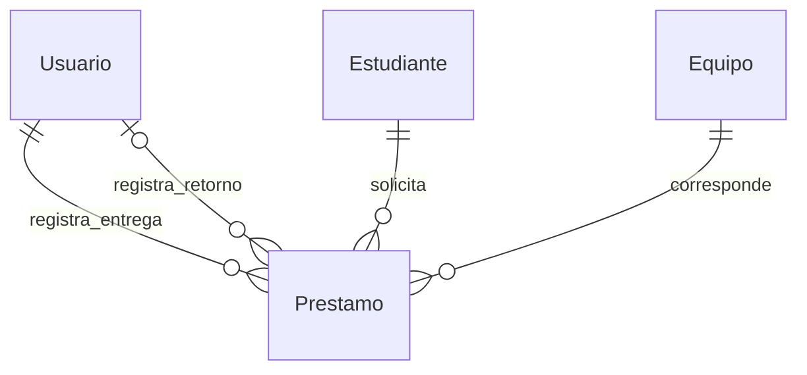

# P03 — Modelo inicial de datos

**Proyecto:** Sistema de Gestión y Control de Préstamos de Equipos de Red de Laboratorio  
**Curso:** Ingeniería de Software (CIB02), UNI-FIEE, Grupo 5, 2026-II  
**Responsable:** M2 — Inventario de equipos y base de datos  
**Motor:** Microsoft SQL Server  
**Versión:** 1.0 — Propuesta para revisión del grupo

## 1. Objetivo y alcance

Definir la estructura compartida para los módulos de acceso, estudiantes, inventario, préstamos, devoluciones y reportes. El modelo se basa en el avance de Semana 10 (secciones 5.1–5.7) y la planificación de Semana 15. Se proponen cuatro tablas; cada préstamo corresponde a un equipo y su devolución se registra en la misma fila. Los nombres, tamaños y restricciones técnicas aquí definidos son propuestas de implementación para acordar con el grupo.

## 2. Diccionario de datos

PK = clave primaria; FK = clave foránea; UQ = único. NN = NOT NULL. Los identificadores PK son INT IDENTITY(1,1).

### Usuario

| Campo | Tipo SQL Server | Restricción / finalidad |
|---|---|---|
| id_usuario | INT IDENTITY(1,1) | PK |
| nombre_usuario | NVARCHAR(50) | NN, UQ; inicio de sesión |
| password_hash | NVARCHAR(255) | NN; hash seguro de contraseña, nunca texto plano |
| rol | NVARCHAR(20) | NN; ADMINISTRADOR o ENCARGADO (roles preliminares) |
| activo | BIT | NN; por defecto 1 |

### Estudiante

| Campo | Tipo SQL Server | Restricción / finalidad |
|---|---|---|
| id_estudiante | INT IDENTITY(1,1) | PK |
| codigo_universitario | NVARCHAR(20) | NN, UQ |
| nombres | NVARCHAR(100) | NN |
| apellidos | NVARCHAR(100) | NN |

El estudiante es solicitante y no tiene acceso directo a la aplicación.

### Equipo

| Campo | Tipo SQL Server | Restricción / finalidad |
|---|---|---|
| id_equipo | INT IDENTITY(1,1) | PK |
| codigo_inventario | NVARCHAR(30) | NN, UQ |
| tipo | NVARCHAR(30) | NN; ROUTER, SWITCH, PUNTO_ACCESO; otros por acordar |
| marca | NVARCHAR(50) | NN |
| modelo | NVARCHAR(80) | NN |
| numero_serie | NVARCHAR(80) | NULL |
| ubicacion | NVARCHAR(100) | NULL |
| estado_fisico | NVARCHAR(20) | NN; OPERATIVO, DANADO, MANTENIMIENTO |
| observaciones | NVARCHAR(500) | NULL |
| activo | BIT | NN; por defecto 1; baja lógica |

La disponibilidad no se almacena. Un equipo disponible cumple simultáneamente: activo = 1, estado_fisico = OPERATIVO y ningún préstamo abierto.

### Prestamo

| Campo | Tipo SQL Server | Restricción / finalidad |
|---|---|---|
| id_prestamo | INT IDENTITY(1,1) | PK |
| id_estudiante | INT | NN, FK a Estudiante |
| id_equipo | INT | NN, FK a Equipo |
| id_usuario_prestamo | INT | NN, FK a Usuario; registra la entrega |
| fecha_prestamo | DATETIME2(0) | NN |
| fecha_prevista | DATETIME2(0) | NN; no anterior a fecha_prestamo |
| fecha_devolucion | DATETIME2(0) | NULL; no anterior a fecha_prestamo |
| condicion_retorno | NVARCHAR(20) | NULL hasta el retorno; mismos valores que estado_fisico |
| observaciones_retorno | NVARCHAR(500) | NULL |
| id_usuario_devolucion | INT | NULL hasta el retorno; FK a Usuario |

Un préstamo abierto tiene fecha_devolucion NULL. Un préstamo cerrado debe registrar fecha_devolucion, condicion_retorno e id_usuario_devolucion; las observaciones son opcionales. Se propone obtener la situación del préstamo mediante consulta: DEVUELTO si tiene fecha real; VENCIDO si está abierto y fecha_prevista es anterior a la hora actual; ACTIVO en los demás casos abiertos. Un préstamo vencido sigue bloqueando la disponibilidad del equipo.

## 3. Relaciones

Cada préstamo tiene exactamente un estudiante, un equipo y un usuario que registra la entrega; el usuario que recibe la devolución es opcional hasta el cierre. Cada entidad puede participar en múltiples préstamos históricos. No se permiten eliminaciones en cascada que destruyan el historial.

## 4. Reglas de negocio e integridad

| Regla del avance | Aplicación propuesta |
|---|---|
| RN-01 | UNIQUE en Equipo.codigo_inventario. |
| RN-02 | FK obligatorias a Estudiante y Equipo. |
| RN-03 | Índice único filtrado sobre Prestamo.id_equipo donde fecha_devolucion IS NULL. Incluye préstamos vencidos abiertos. |
| RN-04 | CHECK fecha_prevista >= fecha_prestamo. |
| RN-05 | Cierre transaccional únicamente cuando fecha_devolucion IS NULL; comprobar que se actualizó una sola fila. |
| RN-06 | Validar equipo activo, operativo y sin préstamo abierto dentro de la transacción de registro. |
| RN-07 | Conservar registros cerrados y datos de retorno; sin borrado en cascada. |
| RN-08 | Desactivar el equipo mediante activo = 0; se propone impedir la baja mientras tenga un préstamo abierto. |
| RN-09 | Derivar disponibilidad mediante consulta o vista, no mediante columna persistida. |

Se propone validar mediante CHECK los valores enumerados y la coherencia de los campos de devolución (todos los campos obligatorios de retorno nulos si está abierto y no nulos si está cerrado). Para evitar carreras entre módulos, las operaciones de préstamo, devolución, cambio de condición y baja deben coordinarse mediante transacciones que bloqueen la misma fila de Equipo antes de validar y modificar datos. Al devolver, actualizar la condición física del equipo y cerrar el préstamo en la misma transacción. La aplicación debe utilizar JDBC y PreparedStatement.

## 5. Ejemplos de verificación previstos

| Caso | Resultado esperado |
|---|---|
| Registrar RT-001 operativo y activo, sin préstamo | Disponible |
| Registrar préstamo de RT-001 a estudiante existente | No disponible |
| Intentar otro préstamo del mismo equipo, incluso si el anterior está vencido | Rechazado |
| Devolver RT-001 operativo | Disponible si sigue activo |
| Devolver un equipo dañado | No disponible |
| Repetir una devolución | Rechazada; registro original intacto |
| Desactivar un equipo sin préstamo abierto | No disponible; historial conservado |

Estos son casos previstos, no pruebas ejecutadas.

## 6. Integración y acuerdos pendientes

- M1 utilizará Usuario y Estudiante; M2, Equipo; M3 y M4, Prestamo; M5 consultará las cuatro tablas.
- Los nombres de campos, valores enumerados, roles, convención de fecha/hora y representación de devolución deben revisarse con los responsables antes de implementar `db/esquema.sql` (P07).
- El SQL ejecutable, los registros ficticios y el backup restaurable son entregables posteriores. No publicar credenciales, contraseñas ni datos personales reales en el repositorio público.

## 7. Referencias internas

- Grupo 5. *Sistema de Gestión y Control de Préstamos de Equipos de Red de Laboratorio. Primer avance del documento de sustentación — Semana 10*, pp. 4–11, 2026.
- *Distribuir trabajo final semana 15*, pp. 3–6, planificación interna del Grupo 5, 2026.
