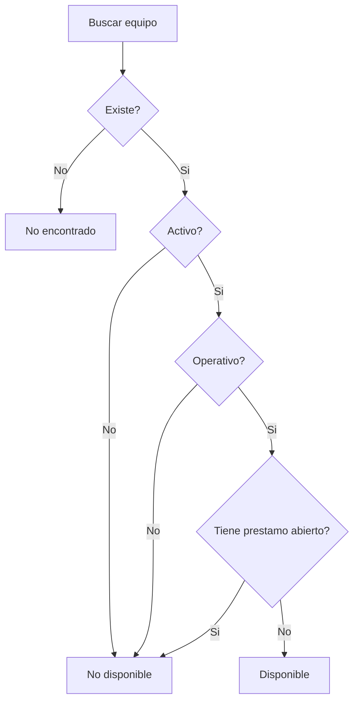
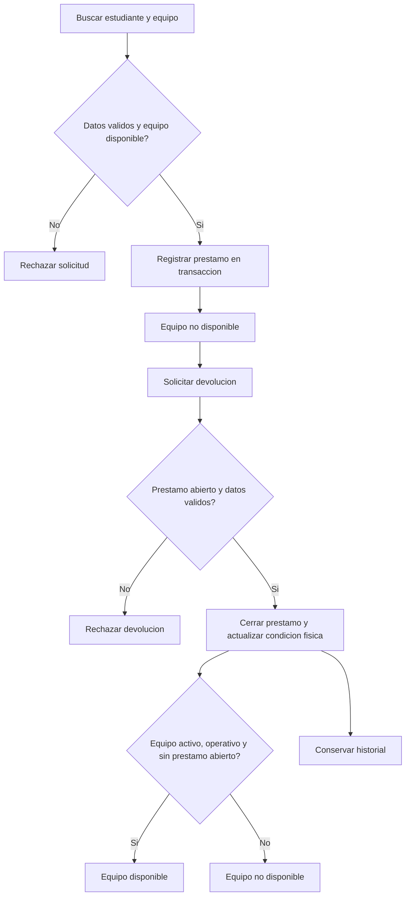

# P04 — Reglas de negocio y operaciones compartidas

**Proyecto:** Sistema de Gestión y Control de Préstamos de Equipos de Red de Laboratorio  
**Curso:** Ingeniería de Software (CIB02), UNI-FIEE, Grupo 5, 2026-II  
**Responsable:** Diego Alonso Escobar Palomino — M3, Gestión de préstamos  
**Versión:** 1.1 — Propuesta para revisión del grupo  
**Dependencia:** P03 — `db/modelo-datos.md`

## 1. Objetivo

Definir las reglas de negocio y las operaciones compartidas que utilizarán los módulos de estudiantes, inventario, préstamos, devoluciones y reportes. Se busca que todos los módulos apliquen los mismos criterios de validación y mantengan la consistencia de los datos en SQL Server.

Este documento establece el comportamiento esperado, no implementa todavía los métodos Java ni el esquema SQL ejecutable. La identificación RN-01 a RN-09 se toma de la correspondencia documentada en P03; el texto se desarrolla a partir de dicha correspondencia y de la planificación del grupo. Debe cotejarse con el avance original de Semana 10 antes de aprobar la versión definitiva.

## 2. Datos y estados compartidos

| Tabla | Campos utilizados en las operaciones |
|---|---|
| `Usuario` | `id_usuario`, `rol`, `activo` |
| `Estudiante` | `id_estudiante`, `codigo_universitario`, `nombres`, `apellidos` |
| `Equipo` | `id_equipo`, `codigo_inventario`, `tipo`, `marca`, `modelo`, `estado_fisico`, `activo` |
| `Prestamo` | `id_prestamo`, `id_estudiante`, `id_equipo`, `id_usuario_prestamo`, `fecha_prestamo`, `fecha_prevista`, `fecha_devolucion`, `condicion_retorno`, `observaciones_retorno`, `id_usuario_devolucion` |

La condición física del equipo puede ser `OPERATIVO`, `DANADO` o `MANTENIMIENTO`. El campo `activo` indica si el equipo continúa en el inventario habilitado (`1`) o fue dado de baja lógicamente (`0`).

La situación del préstamo se obtiene de sus fechas:

| Situación | Condición |
|---|---|
| ACTIVO | `fecha_devolucion IS NULL` y `fecha_prevista` no ha pasado. |
| VENCIDO | `fecha_devolucion IS NULL` y `fecha_prevista` es anterior a la hora actual. |
| DEVUELTO | `fecha_devolucion IS NOT NULL`. |

Los préstamos activos y vencidos son préstamos abiertos. Ambos impiden un nuevo préstamo del mismo equipo.

## 3. Reglas de negocio

| Código | Regla | Validación prevista |
|---|---|---|
| RN-01 | Cada equipo debe tener un código de inventario único. | No permitir dos registros con el mismo `codigo_inventario`; restricción `UNIQUE`. |
| RN-02 | Todo préstamo debe estar asociado a un estudiante y un equipo existentes. | Verificar sus identificadores y aplicar claves foráneas obligatorias. |
| RN-03 | Un equipo no puede tener más de un préstamo abierto simultáneamente. | Rechazar si existe un préstamo con el mismo `id_equipo` y `fecha_devolucion IS NULL`, aunque esté vencido. Utilizar un índice único filtrado como protección de integridad. |
| RN-04 | La fecha prevista de devolución no puede ser anterior a la fecha del préstamo. | Validar `fecha_prevista >= fecha_prestamo` tanto en la aplicación como en la base de datos. |
| RN-05 | Un préstamo solo puede cerrarse una vez. | Actualizar únicamente préstamos abiertos; verificar que se modificó exactamente una fila. |
| RN-06 | Solo se pueden prestar equipos activos, operativos y sin préstamos abiertos. | Comprobar las tres condiciones dentro de la transacción de registro. |
| RN-07 | Se debe conservar el historial de préstamos y devoluciones. | No borrar registros históricos ni permitir eliminaciones en cascada que los destruyan. |
| RN-08 | La baja de un equipo debe realizarse de forma lógica. | Cambiar `Equipo.activo` a `0` sin borrar el registro. Según la propuesta P03, rechazar la baja si tiene un préstamo abierto. |
| RN-09 | La disponibilidad se calcula a partir de los datos del inventario y de los préstamos. | No almacenar una columna de disponibilidad independiente; calcular mediante consulta o vista. |

## 4. Operaciones compartidas

Los nombres de operaciones se proponen como contratos funcionales para acordar con los integrantes. Los identificadores, fechas y estados se corresponden con P03. Las consultas no modifican datos. Las operaciones de escritura deben informar si se completaron o fueron rechazadas, indicando el motivo.

### OP-01 — Buscar estudiante (`buscarEstudiante`)

- **Módulos:** M1 y M3; reutilizable por M5.
- **Entrada:** `codigo_universitario`.
- **Proceso:** validar que el código no esté vacío y consultar `Estudiante` por su código único.
- **Salida:** estudiante encontrado (`id_estudiante`, código, nombres y apellidos), o resultado de no encontrado.
- **Si falla:** informar que el código no existe o no es válido. No registrar un préstamo con un estudiante inexistente.
- **Regla asociada:** RN-02.

### OP-02 — Buscar equipo (`buscarEquipo`)

- **Módulos:** M2 y M3; reutilizable por M4 y M5.
- **Entrada:** `codigo_inventario`.
- **Proceso:** validar el código y consultar `Equipo` por su código único.
- **Salida:** datos del equipo, incluido `id_equipo`, `estado_fisico` y `activo`, o resultado de no encontrado.
- **Si falla:** informar que el equipo no existe. Encontrar un equipo no significa que esté disponible.
- **Reglas asociadas:** RN-01 y RN-02.

### OP-03 — Verificar disponibilidad (`verificarDisponibilidad`)

- **Módulos:** M2, M3, M4 y M5.
- **Entrada:** `id_equipo`.
- **Proceso:** verificar que el equipo exista, esté activo, tenga condición `OPERATIVO` y no tenga ningún préstamo con `fecha_devolucion IS NULL`.
- **Salida:** disponible o no disponible, con motivo cuando corresponda. Si el equipo no existe, informar que no se encontró.
- **Reglas asociadas:** RN-03, RN-06, RN-08 y RN-09.

```text
Disponible = equipo existente Y activo = 1
             Y estado_fisico = OPERATIVO
             Y no existe préstamo abierto
```

La consulta informa la disponibilidad en ese instante. Para registrar un préstamo se debe volver a verificar dentro de la transacción, porque otro usuario podría haber prestado el equipo después de la consulta.

#### Diagrama de verificación de disponibilidad



### OP-04 — Registrar préstamo (`registrarPrestamo`)

- **Módulo responsable:** M3. M1 aporta la identificación del usuario y estudiante; M2 aporta los datos del equipo.
- **Entradas:** `id_estudiante`, `id_equipo`, `id_usuario_prestamo`, `fecha_prestamo` y `fecha_prevista`.
- **Precondiciones:** campos obligatorios completos; usuario de registro existente, activo y autorizado; estudiante y equipo existentes; fechas coherentes; equipo disponible.
- **Proceso:**
  1. Iniciar una transacción y bloquear la fila del equipo según el acuerdo de concurrencia de P03.
  2. Verificar las referencias, los datos de entrada y la disponibilidad actual del equipo.
  3. Insertar el registro en `Prestamo`, dejando nulos `fecha_devolucion`, `condicion_retorno`, `observaciones_retorno` e `id_usuario_devolucion`.
  4. Confirmar la transacción si todo es correcto; en caso contrario, revertirla.
- **Salida:** identificador del préstamo registrado o motivo del rechazo (estudiante inexistente, equipo no disponible, fechas incorrectas, etc.).
- **Postcondición:** se conserva el préstamo abierto y el equipo pasa a estar no disponible por cálculo, sin modificar su condición física ni almacenar un indicador de disponibilidad.
- **Reglas asociadas:** RN-02, RN-03, RN-04, RN-06 y RN-09.

### OP-05 — Cerrar préstamo (`cerrarPrestamo`)

- **Módulo responsable:** M4, coordinado con M3 y M2.
- **Entradas:** `id_prestamo`, `id_usuario_devolucion`, `fecha_devolucion`, `condicion_retorno` y `observaciones_retorno` (opcional).
- **Precondiciones:** préstamo existente y abierto (activo o vencido); usuario de devolución existente, activo y autorizado; fecha real no anterior a `fecha_prestamo`; condición de retorno válida.
- **Proceso:**
  1. Iniciar una transacción e identificar y bloquear la fila de `Equipo` asociada al préstamo, siguiendo el mismo orden de bloqueo que el registro de préstamos.
  2. Volver a comprobar que el préstamo siga abierto.
  3. Actualizar el préstamo con los datos reales de devolución, únicamente si `fecha_devolucion IS NULL`.
  4. Verificar que se actualizó una sola fila y actualizar `Equipo.estado_fisico` con la condición de retorno.
  5. Confirmar ambas modificaciones en la misma transacción o revertirlas si alguna falla.
- **Salida:** confirmación del cierre y disponibilidad resultante, o motivo del rechazo.
- **Postcondición:** el préstamo queda devuelto y permanece en el historial. El equipo solo vuelve a estar disponible si permanece activo, operativo y sin préstamos abiertos.
- **Reglas asociadas:** RN-05, RN-06, RN-07 y RN-09.

## 5. Ejemplo de funcionamiento entre módulos

1. M1 registra al estudiante ficticio `EST-001`.
2. M2 registra el router `RT-001` como activo y operativo, sin préstamos abiertos.
3. M3 busca al estudiante y al router, verifica disponibilidad y registra el préstamo. El router deja de estar disponible.
4. Un segundo intento de prestar `RT-001` es rechazado, incluso cuando el préstamo inicial esté vencido.
5. M4 recibe el router y cierra el préstamo. Si retorna operativo y sigue activo, vuelve a estar disponible; si retorna dañado, no.
6. M5 consulta el préstamo devuelto y sus datos de retorno, que se conservan en la misma fila de `Prestamo`.

#### Flujo compartido de préstamo y devolución



Los diagramas resumen la lógica funcional; las validaciones completas y los límites de las transacciones se detallan en las operaciones OP-01 a OP-05.

## 6. Casos de verificación previstos

| Caso | Acción | Resultado esperado | RN |
|---|---|---|---|
| CP-01 | Registrar otro equipo con código `RT-001`. | Rechazar código duplicado. | RN-01 |
| CP-02 | Registrar préstamo de estudiante o equipo inexistente. | Rechazar; no insertar registro. | RN-02 |
| CP-03 | Intentar prestar un equipo con préstamo abierto, incluido uno vencido. | Rechazar segundo préstamo. | RN-03, RN-06 |
| CP-04 | Usar fecha prevista anterior a la de préstamo. | Rechazar. | RN-04 |
| CP-05 | Cerrar dos veces el mismo préstamo. | Rechazar segundo cierre; preservar la devolución original. | RN-05 |
| CP-06 | Intentar prestar equipo dañado, en mantenimiento o dado de baja. | Rechazar. | RN-06 |
| CP-07 | Consultar el historial tras devolver el equipo. | Mostrar préstamo cerrado y datos de retorno. | RN-07 |
| CP-08 | Dar de baja un equipo sin préstamo abierto; intentar dar de baja otro con préstamo abierto. | Primera baja lógica permitida; segunda rechazada según propuesta P03. | RN-08 |
| CP-09 | Consultar disponibilidad antes del préstamo, durante este y luego de una devolución operativa o dañada. | Disponible antes; no disponible durante; al devolver, depende de la condición física y de si sigue activo. | RN-09 |
| CP-10 | Dos usuarios intentan prestar simultáneamente el mismo equipo disponible. | Solo un préstamo puede confirmarse; no quedan registros contradictorios. | RN-03, RN-06 |
| CP-11 | Registrar una devolución anterior a la fecha de préstamo. | Rechazar sin modificar el préstamo ni el equipo. | RN-05; integridad P03 |

Estos casos describen resultados esperados; todavía no son pruebas ejecutadas.

## 7. Acuerdos para la implementación

- JavaFX y MVC para la aplicación; JDBC y `PreparedStatement` para acceder a SQL Server.
- Centralizar las validaciones compartidas en la lógica de servicios y utilizar restricciones de integridad en la base de datos, evitando criterios distintos entre módulos.
- Coordinar registro de préstamo, devolución, cambio de condición y baja lógica mediante transacciones que bloqueen la misma fila del equipo. Mantener el historial sin eliminaciones físicas en estas operaciones.
- Los módulos de inventario y reportes consultarán la disponibilidad derivada y la situación del préstamo, sin mantener estados duplicados.
- Acordar con los responsables de P03 y los módulos los nombres finales de métodos, permisos por rol y convención de fecha/hora. Los mensajes de error y nombres de operaciones son propuestas de este contrato.
- El esquema SQL ejecutable corresponde a P07 según P03; los métodos Java y las pruebas de integración se realizarán en las tareas posteriores.

## 8. Referencias internas

- Grupo 5, P03 — Modelo inicial de datos, `db/modelo-datos.md`, versión 1.0.
- Grupo 5, *Distribuir trabajo final semana 15*, pp. 3–6 y 7–8, 2026.
- Avance original de Semana 10: referenciado por P03; pendiente de cotejo directo de la redacción de RN-01 a RN-09.
